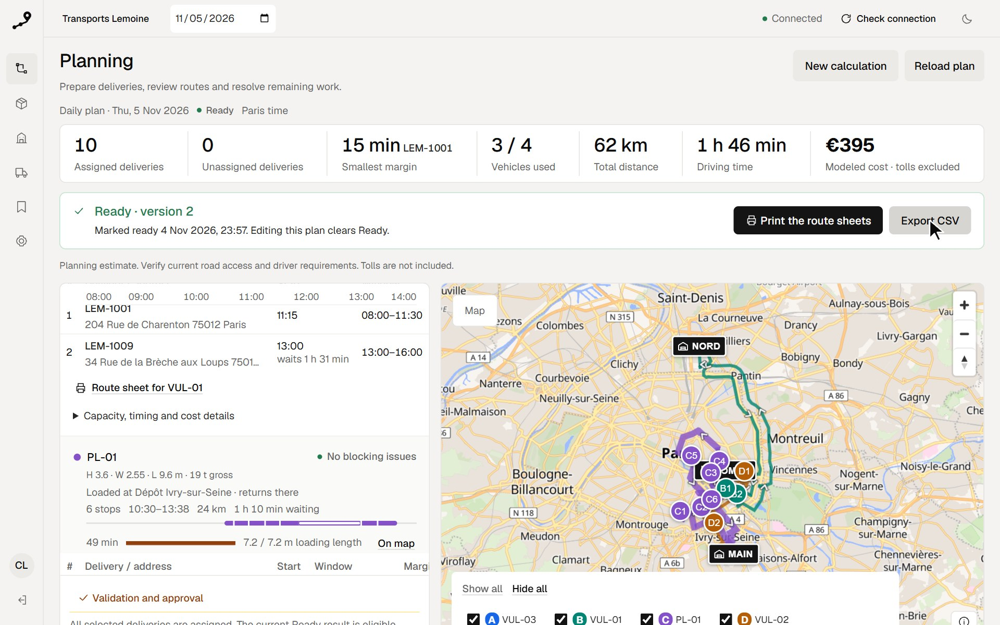
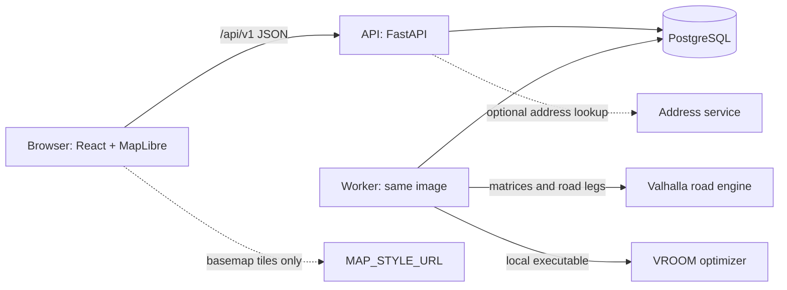

# Tournevia Community

**A self-hosted delivery route planner for a company's own trucks and vans.**
Enter your depot, vehicles and the day's deliveries; Tournevia calculates routes on
real roads, checks them independently, and lets a dispatcher review, adjust and hand
them to drivers. It runs on your own computer or server: no account, no subscription,
no delivery data sent to a planning service.



<sub>Screenshot with fictional data. Map data © OpenStreetMap contributors; basemap by OpenFreeMap, © OpenMapTiles.</sub>

[Website](https://tournevia.com/en/) ·
[User guide](https://tournevia.com/en/docs/user/) ·
[Installation guide](https://tournevia.com/en/docs/developer/installation/) ·
[Developer guide](docs/developer/README.md)

*Français : le guide d'utilisation et le guide d'installation sont sur
[tournevia.com/fr/docs](https://tournevia.com/fr/docs/). L'interface est disponible en
français et en anglais.*

## What it does

- **Plans a day of deliveries.** Vehicles leave loaded from a depot, deliver, and
  return. Each delivery can have a time window, a service duration, a priority and
  required equipment; each vehicle has working hours, days off and optional limits on
  stops, distance and driving time.
- **Respects what a truck can carry and where it can drive.** Five capacity
  dimensions (weight, volume, Euro pallets, industrial pallets, loading length) and
  each vehicle's height, width, length, weight and axle load, used when choosing
  roads.
- **Uses real road travel, in both directions.** Travel times and distances come from
  [Valhalla](https://github.com/valhalla/valhalla) on OpenStreetMap data; the
  assignment and order of stops come from [VROOM](https://github.com/VROOM-Project/vroom).
  Both run on your machine.
- **Checks every result independently.** A separate validator recomputes the schedule,
  loads, equipment and limits from the final road legs. A plan with a known violation
  cannot be marked ready.
- **Keeps the dispatcher in charge.** Review routes on a map, move a stop to another
  vehicle or position, recalculate, then mark the plan **Ready**. Only a Ready plan
  gives a dispatch CSV file and printable route sheets, one per driver.
- **Gets data in without retyping.** CSV import with a preview before anything is
  saved, saved customers, automatic delivery numbers, several depots and other start
  or end places, and optional address lookup for France.
- **Is made for a small team.** Named accounts with administrator and planner roles,
  English and French, light and dark themes, a first-use guide and example deliveries
  to try a calculation before entering your own.
- **Can be operated.** Docker Compose on one host, HTTPS directly or behind your
  existing proxy, backup and restore tooling, a retention command, and optional
  Prometheus metrics.

## What it does not do

Know these before you invest time. They are the current limits of the software;
nothing in the planning model is held back for a paid edition.

- **France, Paris time, euros.** Dates and time windows use the Europe/Paris time
  zone and costs are in euros. Address lookup uses the French national address base.
  Road graphs are prepared for Île-de-France and for France.
- **English and French only.** Adding a language currently means code changes; see
  the [frontend guide](docs/developer/frontend.md).
- **Truck routing for every vehicle.** Vans are routed with the truck profile at
  their own dimensions and weight. There is no separate car or light-van profile yet.
- **One company per installation, delivery-only days.** No pickups, no scheduled
  driver breaks, no overnight shifts, no live traffic, no tolls in the cost, no
  re-planning during the day, no driver app.
- **Bounded size.** One calculation takes up to 25 vehicles, 250 deliveries and 3
  distinct truck profiles, within 200 km by default.
- **A planning estimate, not a legal check.** Verify current road access and driver
  requirements yourself before dispatch.

## Status

Version 0.8.0 is the first tagged release, and it is pre-1.0. A release is a source
kit; the release workflow also builds the application image and publishes it to
GitHub's container registry, named on the release's page (see
[releases and source kits](deploy/RELEASE.md)). The steps below build the images from
source. The planner has been tested on fictional workloads up to 25 vehicles and 250
deliveries in Paris and across Île-de-France (see the
[quality checks](docs/06-testing-and-operations.md#implemented-synthetic-quality-checks));
it has not yet been accepted against a real operator's fleet and working day. Security
fixes are made on the main branch and released with the next version; see
[SECURITY.md](SECURITY.md).

## Try it on your computer

You need Docker with Linux containers (Docker Desktop on Windows, Docker Engine with
the Compose plugin on Linux), Docker Compose 2.24.4 or later, Python 3.11 or later for
the two helper scripts (they use only the standard library), and about 2 GB of free
disk. The build target is Linux AMD64.

From the repository folder (use `python3` on macOS and Linux):

```bash
docker build -f deploy/Dockerfile.vroom -t tournevia-vroom:1.14.0 .
```

```bash
docker build --target runtime -t tournevia-app:local .
```

```bash
python scripts/prepare_routing.py
```

```bash
python scripts/start_local.py --routing-config region/valhalla.json
```

1. The two builds compile the optimizer and build the application image; the first
   takes several minutes.
2. `prepare_routing.py` downloads the Île-de-France road data (about 340 MB) and builds
   the routing graph, once. It took about 7 minutes on a Windows desktop.
3. `start_local.py` starts a private workspace at [localhost:8007](http://localhost:8007)
   with its own database, generated passwords and the routing service inside it, and
   prints the path of a first-use shortcut. Open that file (on macOS and Linux, open
   the address on its `URL=` line), then create your company and its administrator.

In the setup guide, choose the example deliveries, select them and the example vehicles,
and start a calculation on Planning. Running `start_local.py` again, without options,
resumes the same workspace. Keep `deploy/runtime/local-workspace` private: it holds the
installation's secrets. If port 8007 is taken, the launcher says so; add `--port 8010`.

Each of these steps has been run on Windows with Docker Desktop. They have not yet been
run on Linux Docker Engine or on macOS. More detail, options and error messages are in
[First route on your computer](deploy/README.md#first-route-on-your-computer).

## Install for a team

A shared installation needs a domain and HTTPS. `scripts/start_server.py` generates
the secrets, starts the stack, and either serves HTTPS with your certificate or joins
an existing Docker reverse proxy:

- [HTTPS server launcher](deploy/README.md#https-server-launcher)
- [Behind an existing HTTPS proxy](deploy/README.md#behind-an-existing-https-proxy)
- [Routing service in Compose](deploy/README.md#routing-service-in-compose) and
  [routing for all of France](deploy/README.md#routing-for-all-of-france)
- [Server sizes measured by scenario](deploy/README.md#requirements-by-scenario):
  2 vCPU / 8 GB handles up to about 100 deliveries a day in one city; 250 deliveries
  across a region needs 8 vCPU / 32 GB
- [Backups, upgrades and recovery](deploy/README.md#database-roles-upgrades-and-recovery)

The website's [installation guide](https://tournevia.com/en/docs/developer/installation/)
covers both the local and the server installation.

## Your data

Routing, optimization and storage run on your host. Two things can leave it, and both
are yours to change:

- **Basemap tiles.** The browser loads the background map from the provider in
  `MAP_STYLE_URL` (OpenFreeMap Liberty by default). That provider sees each viewer's
  network address and the area being viewed, never your deliveries or routes.
- **Address lookup, if you turn it on.** An administrator can enable the public IGN
  address service; typed addresses, with the depot's position as a hint, are then sent
  to it. You can run your own geocoder instead, or leave lookup off and place points
  on the map.

Tournevia has no analytics and reports nothing to the project.

## Documentation

| For | Read |
|---|---|
| Dispatchers and administrators | [User guide](https://tournevia.com/en/docs/user/), [FAQ](https://tournevia.com/en/docs/user/faq/), [troubleshooting](https://tournevia.com/en/docs/user/troubleshooting/) on the website |
| Operators | [Installing and operating](deploy/README.md), [settings reference](deploy/SETTINGS.md), [releases and source kits](deploy/RELEASE.md) |
| Contributors | [Developer guide](docs/developer/README.md): how the code is organized, how a calculation runs, and how to change or upgrade each part |
| API users | [OpenAPI contract](backend/openapi.json) (also served at `/api/openapi.json`), [JSON schemas](schemas/), [examples](examples/README.md) |
| What changed | [Changelog](CHANGELOG.md) |

The numbered documents record the scope and the design decisions made while building
the product. Where one differs from the developer guide or the code, the code is
right.

| Document | Purpose |
|---|---|
| [1. Scope](docs/01-scope.md) | First supported customer workflow and model boundaries |
| [2. Architecture](docs/02-architecture.md) | Modules, worker, company ownership and mutable plans |
| [3. Data contracts](docs/03-data-contracts.md) | Units, records, imports and response semantics |
| [4. Routing and optimization](docs/04-routing-and-validation.md) | Core model, forbidden connections, objectives, geometry and validation |
| [5. API and workspace](docs/05-api-and-workspace.md) | Endpoints, screens, map behavior, edit conflicts and export |
| [6. Tests and operations](docs/06-testing-and-operations.md) | Quality benchmarks, access controls, basic logs and recovery |
| [7. Product roadmap](docs/07-deferred-scope.md) | Shipped features, release gates and next extensions |
| [8. Sources](docs/08-source-register.md) | Primary references and verification limits |
| [9. Open source and possible later services](docs/09-open-source-and-paid-plans.md) | The licence, and the rules any later paid service follows |

## How it is built

One application, not a set of services: the API and the worker are two processes from
the same image and share only the database.



| Part | Choice |
|---|---|
| Browser | React, TypeScript and MapLibre; compiled assets served by the API |
| Backend | FastAPI, Pydantic, SQLAlchemy and Alembic, organized by domain |
| Storage | PostgreSQL |
| Long jobs | One worker process and a database jobs table |
| Road routing | Valhalla, on graphs built from Geofabrik OpenStreetMap extracts |
| Optimization | VROOM, run by the worker with matrices from Valhalla |
| Deployment | Docker Compose on one host |

The API contract, JSON schemas, TypeScript types, form limits and CSV columns are
generated from the application models; `python scripts/export_contracts.py --check`
fails when they drift.

## Contributing

Contributions are welcome; start with [CONTRIBUTING.md](CONTRIBUTING.md) and the
[development workflow](docs/developer/development.md), which lists how to run each
part and the checks to run before a commit. Use fictional data in issues, tests and
screenshots. Report security problems privately as described in
[SECURITY.md](SECURITY.md).

## License

Tournevia Community is licensed under [Apache-2.0](LICENSE). Road data, the basemap,
the address base and the bundled engines and libraries keep their own licences and
attribution requirements; see [NOTICE.md](NOTICE.md).
