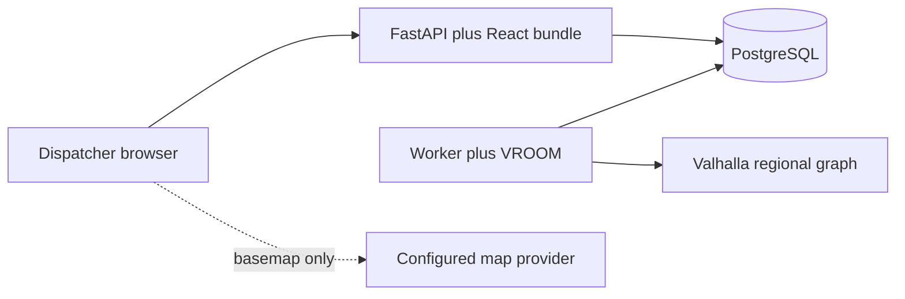

# 2. Architecture

## Decision: one modular application and one compute worker

Tournevia uses FastAPI, Pydantic and SQLAlchemy/Alembic with PostgreSQL. The API serves the compiled React/MapLibre application. Long planning tasks run in a separate worker from the same application image; the worker calls Valhalla and runs VROOM as a local executable.



The separate worker is for resource isolation and durable job state, not microservices. Optimization never runs inside an HTTP request or as an in-process web background task. FastAPI documents the distinction between lightweight background work and heavier computation. [S11](08-source-register.md)

## Deployment defaults, not new services

The first Valhalla graph uses the Geofabrik Île-de-France OSM extract; a France graph is also prepared. The browser uses OpenFreeMap Liberty through `MAP_STYLE_URL`; the API/worker still route exclusively through the private Valhalla service. Coordinates enter through imports/forms and manual pin review. Address lookup is optional and off by default: an installation's own Base Adresse Nationale geocoder (`GEOCODER_URL`), or IGN's public service when a company's administrator turns it on. A found address is a proposal; the entrance is still reviewed. A basemap covers what it can display, not what this installation can route. See the [deployment notes](../deploy/README.md).

No tile server, hosted subscription service or extra application container is required. Operators can replace the map-style URL without changing the planner model.

## Module boundaries

```text
backend/app/
  main.py, *_api.py          # API wiring, not routing logic
  db.py                      # Database setup
  accounts.py, auth.py       # Organizations, users and sessions
  fleet.py, records.py       # Depots and places, vehicles, deliveries, customers
  imports.py, numbering.py   # CSV imports and delivery numbers
  jobs.py, edits.py          # Jobs, editable plans and finalization
  routing.py                 # Valhalla request/response adapter
  optimization.py            # VROOM mapping and bounded execution
  validation.py              # Independent model checks
  worker.py                  # Job loop
backend/migrations/
backend/tests/
web/src/
deploy/
```

Each domain is one module until it has enough real code to split; the [developer guide](developer/backend.md#module-map) describes every file. Domain calculation functions do not depend on HTTP request objects, and there are no generic repositories, provider registries, event buses or dependency-injection frameworks.

## Company ownership without building SaaS yet

An `organizations` table owns the company's records: each has an `organization_id`, and a user belongs to one organization. Ownership comes from the authenticated session, never from a client-supplied field. Every lookup, list, import, job, edit and export checks it, and relationships must stay within one organization. The tests use two synthetic organizations even though an installation provisions one.

Depots and places are rows with their own ID and organization owner, not a global hard-coded row. A company has one or more; exactly one depot is its main depot, which `/depot` addresses, and `/depots` lists them all. Depot and place codes, delivery identifiers, fleet numbers and customer codes are unique within that organization.

There is no tenant switching, public sign-up, database-per-tenant provisioning, billing or quota. These ownership boundaries are for safe data handling, not a claim that shared hosted tenancy is implemented.

## Jobs

Jobs move `QUEUED → RUNNING → SUCCEEDED | FAILED` in a single database table, with one active worker. Each records its ID, owner, kind, stage, normalized request, input values, timestamps and a safe error. Execution is bounded, and child processes stop when the worker is cancelled or the job times out.

A narrow PostgreSQL singleton guard keeps one worker: it holds a session advisory lock on a dedicated connection that never returns to a pool, and a second worker exits. Losing that connection stops the worker and its child process. On restart, after taking the lock, the worker marks abandoned RUNNING jobs failed; the old worker never reconnects to publish a result. This is a small duplicate-processing protection, not a distributed task system. PostgreSQL documents the lifetime of session advisory locks. [S14](08-source-register.md)

Job completion and its result are saved in one transaction, only while the job is still RUNNING. A new attempt has a new ID, and an edit also compares the reserved plan version. Failed optimization work is never replayed silently, and a database or engine failure is never recorded as a successful empty plan.

Limits: a configurable whole-job deadline (180 s by default; the initial 120 s left no headroom once regional 250-delivery jobs measured 118–123 s), a 1–60 second solver budget shortened to what the deadline leaves, one solver thread and bounded HTTP timeouts. VROOM runs without a shell, in a private temporary directory, with capped output; on timeout its process group is killed and reaped. The interface polls every two seconds while a job is active.

Network retries reuse an idempotency key scoped to organization, user and operation, compared on the normalized request JSON; no content fingerprint is kept. Records last for a documented retry window, after which the same key is not guaranteed to deduplicate.

## Editable plans, not a history system

A plan is one current row: integer `version`, status, input values, route result, validation and timestamps. The selected input values are copied, so a calculation and its export do not change while someone edits the live records. There is no chain of historical plan objects.

An accepted edit requires `If-Match`, increments the plan version, clears READY, sets validation PENDING and queues a recalculation of the same plan. Only one edit may be active on a plan. The worker writes against the reserved version and increments it again when it saves completion or failure, so a stale result cannot overwrite newer data. The previous route display is marked stale while PENDING.

A parseable but infeasible edit stays a draft with FAIL issues so the dispatcher can correct it. If routing itself fails and no complete new route exists, the old route stays only as stale display data, with FAIL and a message that the edit was not applied. The active-edit marker is cleared in the same transaction on success, failure or interrupted-worker recovery.

A fresh optimization creates a separate plan, because it is an intentional new solve rather than an edit. A copy/compare feature could come later; basic editing does not need it.

Finalization checks the current version, the saved inputs against current source versions, routing origin and model validation, then sets READY and a timestamp. Editing a READY plan returns it to DRAFT. Downloaded CSV files do not change, so the interface warns the dispatcher to redistribute routes after changes. There is no append-only activity ledger or certification record.

## Store only what the product needs

Ordinary tables hold bounded JSONB for plan inputs and route details. Matrices and request-local index maps live in the job workspace only as long as the computation needs them; edits fetch fresh routing for their selected legs. Matrices and engine responses are not kept. A plan keeps its dataset label and the actual truck-profile values for display and troubleshooting; build and engine versions belong to the deployment information.

One host is one failure domain. A working backup/restore and recoverable job failures are the first resilience baseline; high availability and multiple worker pools wait for measured need.
