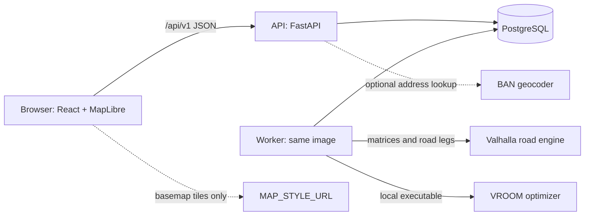

# Developer guide

This guide is for people who want to understand, change or extend Tournevia's code. It explains how the
system is built, where each piece of behavior lives, and how to make common changes without breaking the
guarantees the planner depends on.

The other documents serve different readers:

- The numbered documents in [docs/](../) record the product's scope and the design decisions behind it:
  why things are built the way they are.
- [deploy/README.md](../../deploy/README.md) is the operator and command reference: installation, Compose
  files, routing graphs, backups, HTTPS and every tested command.
- This guide is the map between the two: what the code does, where it does it, and how to change it.

## Read in this order

| Page | What it answers |
|---|---|
| [1. System architecture](architecture.md) | Which processes run, how a request and a calculation travel through them, how data is stored and protected |
| [2. Backend](backend.md) | Every Python module, the calculation pipeline in code, conventions for handlers, errors, versions and ownership |
| [3. Frontend](frontend.md) | The React application: screens, data flow, generated types, translations, styles, the map and tests |
| [4. Development workflow](development.md) | Running each part locally, the checks to run before a commit, what CI runs |
| [5. Making changes](making-changes.md) | Step-by-step recipes: a new field, setting, endpoint, migration, CSV column, translation, validation rule |
| [6. Upgrading dependencies and engines](upgrading.md) | Python and npm packages, base images, PostgreSQL, VROOM, Valhalla, the road graph, version numbers |

## Tournevia in one minute

Tournevia plans delivery routes for one company. A dispatcher enters a depot, vehicles and the day's
deliveries, then asks for a calculation. The server copies the selected records, and a separate worker
process asks a road-routing engine (Valhalla) for real travel times between every pair of points. An
optimizer (VROOM) then assigns deliveries to vehicles and orders them. The worker fetches the actual road
path for every leg and checks the whole result independently before saving it as an editable draft.
The dispatcher reviews the draft on a map, moves stops if needed, marks it ready, and exports a CSV file
or prints route sheets for drivers.

It is one modular application, not a set of microservices. The API and the worker are two processes
started from the same Docker image. They never call each other; they share only the database.

## Rules that shape every change

These come from the product's design and are enforced by tests. Keep them when you change things:

1. **The model is the product.** Capacity in five dimensions, hard time windows, equipment, exact truck
   profiles, directed road travel and route limits are never relaxed to make a result look better.
   A constraint the planner cannot honor is rejected with a clear message, never silently ignored.
2. **The solver's answer is not proof.** Every result passes `app/validation.py`, which re-checks it
   against the original inputs and the final road legs. A result with blocking issues cannot be marked ready.
3. **Ownership comes from the session.** Every query is scoped by the organization of the signed-in user.
   No request field ever chooses the caller's organization or role.
4. **Contracts are generated, not written by hand.** The OpenAPI file, JSON schemas, TypeScript types,
   form limits, CSV columns and the list of server messages are produced from the Python models.
   `python scripts/export_contracts.py --check` and `npm run api:check` fail when they drift.
5. **Plans are editable drafts, not a history system.** One current row per plan with an integer version.
   There is no audit ledger, fingerprinting or archive of matrices. Do not add one.
6. **Honest presentation.** Never claim live traffic, tolls, legal compliance or optimality the code does
   not compute. Fictional example data is always labeled as such.

## Where to ask and how to contribute

Read [CONTRIBUTING.md](../../CONTRIBUTING.md) before opening a pull request, and report security problems
privately as described in [SECURITY.md](../../SECURITY.md).
