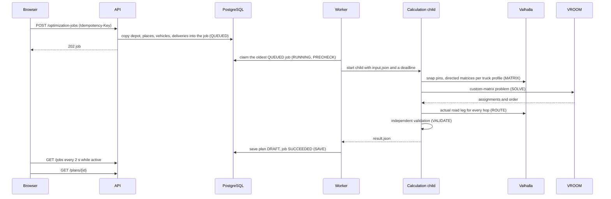
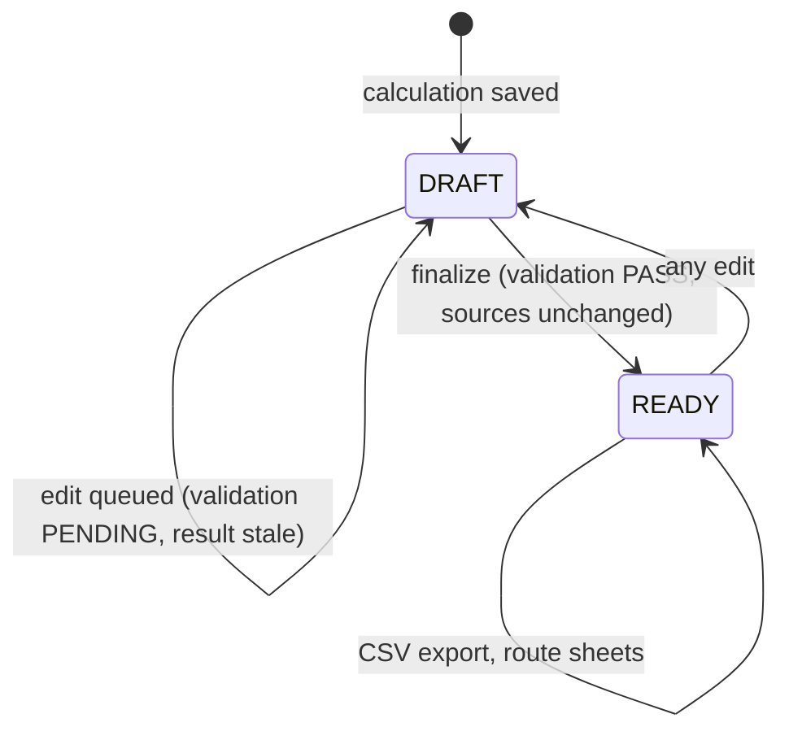
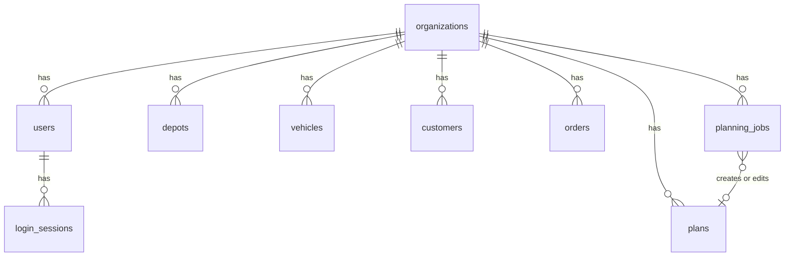

# 1. System architecture

[Developer guide](README.md) › System architecture

This page describes the running system: its processes, how a request and a calculation move through them,
how data is stored, and where the security boundaries are. The reasoning behind these choices is in
[2. Architecture](../02-architecture.md); this page describes what the code actually does today.

## Processes

| Process | Started by | Code | Owns |
|---|---|---|---|
| **PostgreSQL 16** | `postgres` service | [deploy/docker-compose.example.yml](../../deploy/docker-compose.example.yml) | All persistent data. Nothing else stores state. |
| **setup** (one-shot) | `python -m app.setup_database` | [app/setup_database.py](../../backend/app/setup_database.py) | Creates the database roles, runs Alembic migrations, grants the runtime role its rights, then exits. |
| **API** | `python -m app.main` | [app/main.py](../../backend/app/main.py) | HTTP: sessions, records, imports, job submission, plans, exports. Also serves the compiled frontend from `web/dist`. Never computes routes. |
| **worker** | `python -m app.worker` | [app/worker.py](../../backend/app/worker.py) | Takes queued jobs one at a time, runs each in a child process with a deadline, saves the result or a failure. |
| **calculation child** | the worker, per job | `python -m app.worker --compute DIR` | Talks to Valhalla and VROOM for one job. Receives no database credentials. |
| **Valhalla** | separate container or `docker-compose.routing.yml` | [deploy/build_graph.py](../../deploy/build_graph.py) | Road travel-time matrices and road paths over an OpenStreetMap graph. |
| **VROOM** | the calculation child, as an executable | [app/optimization.py](../../backend/app/optimization.py) | Assigns and orders deliveries using the matrices it is given. Built from source by [deploy/Dockerfile.vroom](../../deploy/Dockerfile.vroom) and copied into the application image. |
| **addok** (optional) | `docker-compose.geocoder.yml` | [app/geocoding.py](../../backend/app/geocoding.py) | Address search over the national address base, inside the installation. |
| **nginx** (optional) | `docker-compose.https.yml` or `docker-compose.proxied.yml` | [deploy/nginx.conf](../../deploy/nginx.conf) | TLS (or a plain hop behind another proxy), body limits, sign-in rate limit, the visitor-address header. |

The API, setup and worker all use the same image, built by the root [Dockerfile](../../Dockerfile). Its
stages: `web` builds the frontend with Node, `solver` takes the VROOM binary, `runtime` is the application
(`app` is the same image as the default target), and `engine-test` adds tests and benchmarks on top of
`runtime`.

A singleton guard makes sure only one worker runs: it holds a PostgreSQL advisory lock on a dedicated
connection. A second worker cannot take the lock and exits. If that connection is lost, the worker stops
instead of reconnecting, so a stale worker can never publish a result.

## Installation modes

`APP_MODE` decides how people sign in. It is read by [app/config.py](../../backend/app/config.py).

| Mode | Used by | Sign-in | Cookie |
|---|---|---|---|
| `local` | `scripts/start_local.py` on one computer | Named accounts over loopback HTTP | `vrp_local_session` |
| `shared` | servers, behind HTTPS | Named accounts; `PUBLIC_ORIGIN` must be HTTPS | `__Host-vrp_session` (Secure) |
| `local_demo` | legacy demonstration and the test fixtures | None: one built-in admin identity on the demo company | none |

In `local` and `shared` modes the first company, depot and administrator are created by first-use setup
(`POST /api/v1/setup`), authorized by the private `SETUP_TOKEN`. There is no public registration. In
`local_demo`, setup refuses; `python -m app.setup_database` provisions the demonstration company instead.

## Life of an API request

Every request passes the same layers, outermost first (see `create_app` in
[app/main.py](../../backend/app/main.py); Starlette runs the middleware added last first):

1. **Request log** ([app/http_logging.py](../../backend/app/http_logging.py)) writes one bounded line per
   request, without URLs, bodies or credentials.
2. **Origin check.** A request with an `Origin` header must come from `PUBLIC_ORIGIN`. Every write
   (`POST`, `PUT`, `PATCH`, `DELETE`) must send an `Origin` equal to `PUBLIC_ORIGIN` and
   `X-VRP-Request: 1`. The response gets the security headers: a strict Content-Security-Policy,
   `X-Frame-Options: DENY`, `no-store` on `/api/`.
3. **Trusted host** accepts only `localhost`, `127.0.0.1` and the host of `PUBLIC_ORIGIN`.
4. **Body limit** ([app/http_limits.py](../../backend/app/http_limits.py)) refuses oversized bodies before
   JSON parsing.
5. **Session dependency** `current_session` ([app/auth.py](../../backend/app/auth.py)), on every route
   that requires a session, reads the cookie,
   checks expiry (8 hours absolute, 30 minutes idle) and, on writes, the `X-CSRF-Token` header. It puts the
   identity on `request.state`; handlers read it with `who(request)`. Requests marked
   `X-VRP-Background: 1` (automatic polls) do not extend the idle timer.
6. **Handler** (in `data_api.py`, `jobs_api.py`, `auth_api.py`, `onboarding.py`, `monitoring.py`) opens a
   database session and calls an ordinary domain function with the organization from `who(request)`.
7. **Errors** become JSON. A domain function raises `DataError(status, CODE, message)` and the client
   receives `{"code": ..., "detail": ..., "identifiers": [...]}`. Validation errors are rewritten without
   echoing input values (passwords never return). Database errors are answered by their PostgreSQL
   error code: a lock wait or statement timeout is 409 `DATABASE_BUSY`, a value the database cannot store
   is 422 `INVALID_VALUE`, a constraint conflict is 409 `CONFLICT`, anything else is 503. An unexpected
   exception is a 500 with a `request_id`; the log line with the same ID names the error's class and the
   file, line and function of each application frame, never its message or values.

## Life of a calculation

What each step does, and where:

1. **Submit** (`submit` in [app/jobs.py](../../backend/app/jobs.py)). The API locks the company, replays an
   earlier identical request with the same `Idempotency-Key`, refuses a sixth active job, and checks
   that every delivery pin and every depot or place a selected vehicle starts or ends at is reviewed
   (the main depot only when a selected vehicle uses it), that examples are not mixed with real records,
   that every vehicle works that day, and that those points fit the router's distance limit. It then copies the
   selected records into `planning_jobs.input_data` as a `PlanningInput`. Later edits to vehicles or
   deliveries do not change a running or saved calculation.
2. **Claim** (`Worker.claim`). The worker takes the oldest `QUEUED` job with `SELECT … FOR UPDATE`,
   re-validates its input and marks it `RUNNING`.
3. **Compute** (`Worker.compute`). The worker writes the input to a private temporary directory and
   starts the child with a memory limit (1.5 GB), a file-size limit and an environment that holds only
   routing settings. While the child runs, the worker updates the job's stage and heartbeat, enforces the
   deadline (`JOB_TIMEOUT_SECONDS`, 180 s by default, less a few seconds kept for saving) and caps the
   child's output. A cancelled job stops the child.
4. **Calculate** (`calculate` in [app/spike.py](../../backend/app/spike.py)): the pipeline is described
   step by step in [Backend › The calculation pipeline](backend.md#the-calculation-pipeline).
5. **Save** (`save_result` in [app/jobs.py](../../backend/app/jobs.py)). In one transaction, and only if the
   job is still `RUNNING`, the worker checks that the result covers exactly the saved deliveries and
   vehicles, then creates the plan (or updates the edited one) and marks the job `SUCCEEDED`. The job's
   copy of the input moves to the plan.

A failure at any step marks the job `FAILED` with a code and a message the interface can translate.
No partial or empty plan is ever saved in place of a failure. If the worker dies, the next worker to
take the lock marks the abandoned `RUNNING` jobs `FAILED` (`WORKER_INTERRUPTED`) and deletes their
temporary directories.

### Job states

`QUEUED` → `RUNNING` (stages `PRECHECK`, `MATRIX`, `SOLVE`, `ROUTE`, `VALIDATE`, `SAVE`) → `SUCCEEDED`
or `FAILED`. Database check constraints on `planning_jobs` enforce which columns are set in each state.
There are two kinds of job: `OPTIMIZE` (a new calculation, creates a new plan) and `EDIT` (a manual
change to an existing plan's assignments, recalculates only its road legs).

## Life of a plan

A plan row ([app/jobs.py](../../backend/app/jobs.py), table `plans`) holds the input copy, the current
result, a `version` integer, `status` (`DRAFT` or `READY`) and `validation` (`PENDING`, `PASS` or
`FAIL`).

- **Edit** (`submit_edit` in [app/edits.py](../../backend/app/edits.py)): requires `If-Match` with the
  plan version and an `Idempotency-Key`. It increments the version, returns the plan to `DRAFT`, marks the
  result stale and queues an `EDIT` job. Only one edit may be active per plan.
- **Finalize** (`finalize`): requires the current version, source records that have not changed since
  the calculation, a passing validation that it runs again on the saved inputs, a company workspace (plans of
  a sample workspace, `SYNTHETIC`, are never operational), and explicit acceptance when deliveries are unassigned. When
  another READY plan for the day already dispatches some of the same vehicles or deliveries, it refuses
  unless the dispatcher asks to replace it; the other plan then returns to `DRAFT`.
- **Export** (`export_csv`, `route_sheets`): only a current READY plan, at the version the dispatcher saw.
  A plan of example records can be made READY to try the workflow; its CSV and route sheets are marked
  "Example data, not for driving".
  Spreadsheet formulas in cell values are neutralized.

## Data model

Vehicles, deliveries (`orders`) and customers share one shape: `id`, `organization_id`, an `identifier`
unique within the company (fleet number, delivery number, customer code), a `version` integer for edit
conflicts, an `example` flag on vehicles and deliveries, and the record itself in a JSONB `data` column
validated by its Pydantic model. Adding a field to one of them therefore needs no migration, only a model
change; see [Making changes](making-changes.md#add-a-field-to-a-vehicle-delivery-customer-or-depot).

Depots and other places are different: the `depots` table has real columns (code, name, address,
latitude, longitude, reviewed, time zone, kind, main, example) and a `version`. A new depot field needs
a migration.

Company settings are real columns on `organizations` (address lookup, delivery numbering, safety margin)
and do need a migration.

Units are fixed integers everywhere in the API and the database: millimetres, kilograms, cubic
decimetres, metres, seconds, and euro cents (`_minor`). Times are ISO 8601 with their UTC offset; the
planning day is a date in Europe/Paris. Forms convert for display only. See
[3. Data contracts](../03-data-contracts.md).

## Security boundaries

- **Three database roles.** Setup connects with the bootstrap role (`POSTGRES_USER`), which creates the
  two others and applies the grants; Alembic runs as the migration role, which owns the schema. The API and
  worker connect as the runtime role that can read every table, insert and update only the tables it needs, update only the named
  setting columns of `organizations`, and delete source records only through three SQL functions
  (`remove_examples`, `delete_orders`, `delete_depot`). See `grant_statements` in
  [app/database_roles.py](../../backend/app/database_roles.py).
- **Passwords** are hashed with Argon2id. Sign-in attempts are throttled per client address and per
  username. Session tokens are stored as hashes.
- **The calculation child** never receives database or setup secrets, and its error output never reaches
  users: only messages written by the application's own `EngineError` are shown.
- **The browser** loads scripts only from its own origin (`content_security_policy` in `main.py`). The
  map style and its tiles, glyphs and sprites may be fetched from the `MAP_STYLE_URL` origin and other
  HTTPS hosts.
- **Optional services stay private.** Valhalla and addok publish no ports in the Compose overlays.

## Limits

These are model limits, checked in code, not edition limits.

| Limit | Value | Where |
|---|---|---|
| Vehicles per calculation | 25 | `PlanningInput`, `OptimizationRequest` |
| Deliveries per calculation | 250 | same |
| Distinct points per calculation | 301 | `MAX_MATRIX_POINTS` in `routing.py` |
| Truck profiles per calculation | 3 | `points_and_profiles` in `spike.py` |
| Depots and places per calculation | the main depot and 60 others | `PlanningInput.depots` |
| Solver time budget | 1 to 60 s | `solver_time_limit_seconds` |
| Whole job deadline | 180 s (1 to 600) | `JOB_TIMEOUT_SECONDS` |
| Active jobs per company | 5 | `MAX_ACTIVE_JOBS` in `jobs.py` |
| Pin distance to a usable road | 50 m | `snap_limit_m` in `routing.py` |
| Calculation span | 200 km by default | `MATRIX_MAX_KM`, which must equal the graph's `build_graph.py --max-matrix-km` |
